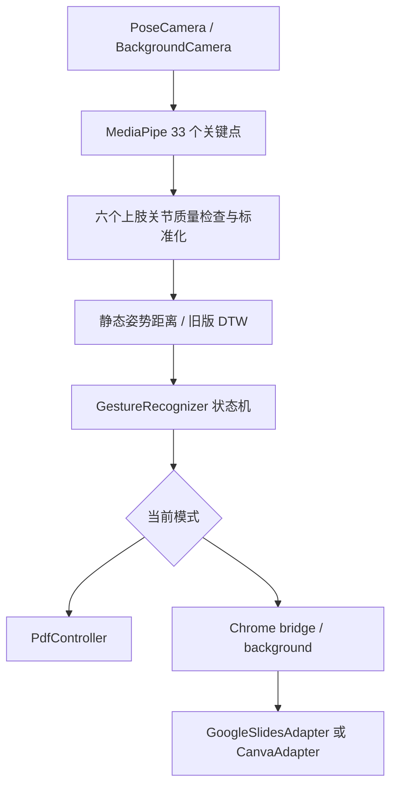
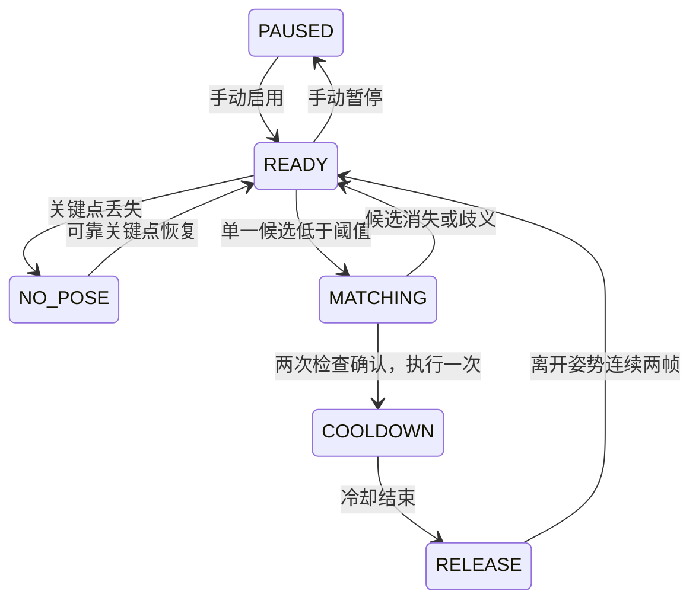

# GestureDeck 技术说明

## 数据流与职责

网站使用 React + TypeScript + Vite；PDF 使用 Mozilla PDF.js；姿势关键点使用 Google MediaPipe Tasks Vision Pose Landmarker Lite。项目自己的工作是预处理、静态姿势模板采集、加权距离比较、旧版动态序列兼容、冲突检测、状态机、持久化、页面操作和桥接。

## 1. 标准化

只比较双肩、双肘和双手腕，共六点、12 个特征。这样上半身入镜即可，不要求膝盖与脚踝。

MediaPipe 给出分别按图像宽高归一化的 x/y，因此先将 x 乘以图像宽高比，避免不同摄像头比例改变几何形状。

以肩膀中心 C 为原点，以校正后的双肩距离 S 为单位：

`x' = (x - Cx) × aspect / S`

`y' = (y - Cy) / S`

这减少站位、画面大小的影响，但不能消除转身透视和严重遮挡。质量门槛取六点 visibility/presence 最小值，低于 0.55、关节超出画面安全区、或肩宽不合适时拒绝该帧。界面依据有效 frame 显示 Ready to use / Adjust camera，不再把原始置信度显示为满分 100 的进度条；可用姿势不需要达到 1.0。没有做心理状态、真实眼神或身份判断。

## 2. 单次静态姿势模板

新版默认只捕捉一次约 650ms 的静态姿势。至少需要 4 个有效帧、有效时长至少 250ms，内部断帧不能超过 400ms。每个坐标取多帧中位数作为代表姿势；如果采样期间最大抖动距离超过 0.16，则要求重拍。采集只保留相对时间与标准化向量。

初始匹配阈值取 `clamp(0.18 + 2.5 × captureSpread, 0.20, 0.30)`。识别时比较当前帧与代表姿势的加权关节距离。需要在至少 180ms 内获得两次确认；15 FPS 时通常是三次检查，低帧率时可由两帧确认。

新姿势与已有启用姿势比较；过于相似时拒绝保存。触发后必须先离开该姿势连续两帧，才会重新待命，因此一直保持姿势不会连续翻页。导入的旧版动态动作仍按 `motion` 模式兼容，但建议重新捕捉为静态姿势。

## 3. 加权距离与旧版 DTW

`D(i,j) = d(a[i],b[j]) + min(D(i-1,j-1), D(i-1,j), D(i,j-1))`

帧距离是加权关节欧氏距离，手腕权重 1.4、手肘 0.8、肩部 0.25。静态姿势识别直接使用这个距离，因此不要求收集完整动作序列。

旧版动态动作仍使用 DTW：先插值为 24 帧，使用 35% Sakoe-Chiba 窗并按路径长度归一化；在线缓冲最多 2.4 秒，比较 0.65、0.85、1.0、1.2 倍模板时长的后缀窗口。最终距离由 80% DTW 距离和 20% 起终点距离组成。静态姿势的第一、第二候选距离差小于 0.045 时不执行；旧版动态动作使用 0.055。

界面显示 `round(100 × exp(-2.5 × distance))` 的匹配指数，只用于阅读；**不是概率，也不是准确率**。

## 4. 状态机

短时确认、冷却、离开姿势、关键点缺失清空候选，分别防止抖动、连续翻页、保持姿势重复触发与跨断帧拼接。旧版动态动作仍要求离开结束姿势连续三帧。

外部模式启用 `releaseDuringCooldown`：冷却期间已经放下手也会被计入离开姿势；暂时丢失关键点只清空候选，不清掉单次触发锁。PDF 模式保持原有的识别行为。

姿势「暂停」可以让系统停下；恢复走显式按钮 / 固定键盘快捷键，因此不会让识别器在被暂停时继续检测其他姿势。

## 5. PDF

`PdfController` 持有加载任务和渲染任务。快速切页先取消上一项 render 并等待结束，再在同一 canvas 渲染；版本号使过时任务无法覆盖新内容。使用本地 CMap、标准字体和解码 WASM。PDF 不上传服务器；不运行 PDF 内嵌 JavaScript。加密 PDF 要求先去除密码。

## 6. Chrome 连接器

网站 → 同源 `window.postMessage` → bridge content script → MV3 service worker → 选定标签页的 presentation content script → 平台适配器。

外部模式摄像头在 offscreen 文档中运行。`BackgroundCamera` 通过 `MediaStreamTrackProcessor` 直接获取原生 VideoFrame。预览从原始帧绘制，识别线程空闲时接收一帧。线程使用 Lite 模型，优先尝试 GPU，失败时回退到 CPU。原始帧由持有它的一端负责关闭，取帧与识别各最多保留一个待处理帧。

纯静态姿势配置在 1600ms 内获得连续两帧即可进入 Ready；含旧版动态动作的配置要求 350ms 内连续三帧。就绪检查不会反复重置已启动的识别器；暂停只响应用户指令。视频冻结超过 8 秒则停止并显示明确错误。界面显示约 1.5 秒窗口内实测的 recognition FPS。

网站仅允许 `http://localhost:5173` / `http://127.0.0.1:5173`。后台再次检查 sender、来源、顶层 frame、目标 URL、姿势数据结构、命令枚举与会话归属。START / STOP / PAUSE、标签页事件和状态消息顺序执行，避免异步状态覆盖；只读 PING 单独处理，避免模型加载期间被误判为断开。目标默认绑定用户选择的 tab ID 和演示文稿 ID；演示页出现后，后台只跟随同一文稿的 opener、活动标签页或唯一演示候选。页面内容脚本报告同标签页内的 fullscreen / viewer 状态，使地址不变的 Present 也能被识别。离开选中文稿或关闭目标 / 控制网站停止摄像头。连接器仅对选中的演示标签短暂使用 debugger 派发 `ArrowLeft` / `ArrowRight`，随后立即断开；不使用 native messaging，也不申请所有网站权限。

连接器最多每 50ms 从当前原生帧生成一张本地预览，使用异步 WebP 压缩。每次只处理一张预览，并叠加最近的骨骼结果。控制页隐藏后暂停预览压缩，姿势识别继续。状态每 650ms 或识别状态变化时回传。界面分别测量摄像头供帧、识别结果和预览图像加载速度。

`PresentationAdapter` interface 有 `execute(command)`；GoogleSlidesAdapter 和 CanvaAdapter 继承共享网页导航逻辑并实现各自的演示视图检测。模型匹配代码不知道当前平台，这体现封装、接口、多态与职责分离。

Canva / Google Slides 没有在本项目中使用官方远程翻页 API。上一页和下一页通过 Chrome Debugger 派发浏览器级方向键；DOM 导航按钮作为连接失败后的后备方式。已发送按键不代表已经观察到平台页面变化，平台兼容性必须现场测试。

## 7. 当前边界与下一步

- 单人、上半身正面二维姿势；不保证任意侧面、转身、遮挡或远距离。
- 单次短采样只足够建立个人姿势模板，不能量化覆盖率。需要用独立真人测试测量漏检和误触。
- PDF 摄像头目标约 15 FPS，外部模式目标上限约 20 FPS；实际取决于设备，低帧率会增加延迟。
- 30 个姿势是保存上限，不是低性能电脑的推荐数量。先用 2–4 个差别明显的姿势。
- 网站所有 PDF 会话在内存中；刷新后需要重新上传。姿势配置存在 localStorage，可导出。
- 部分 PDF 特性、动态平台页面、跨源 iframe 和厂商网页更新可能不兼容。

官方参考：

- [MediaPipe Pose Landmarker Web](https://ai.google.dev/edge/mediapipe/solutions/vision/pose_landmarker/web_js)
- [Mozilla PDF.js examples](https://mozilla.github.io/pdf.js/examples/)
- [Chrome Offscreen API](https://developer.chrome.com/docs/extensions/reference/api/offscreen)
- [MediaStreamTrack insertable streams](https://developer.chrome.com/docs/capabilities/web-apis/mediastreamtrack-insertable-media-processing)
- [Chrome content scripts](https://developer.chrome.com/docs/extensions/develop/concepts/content-scripts)
